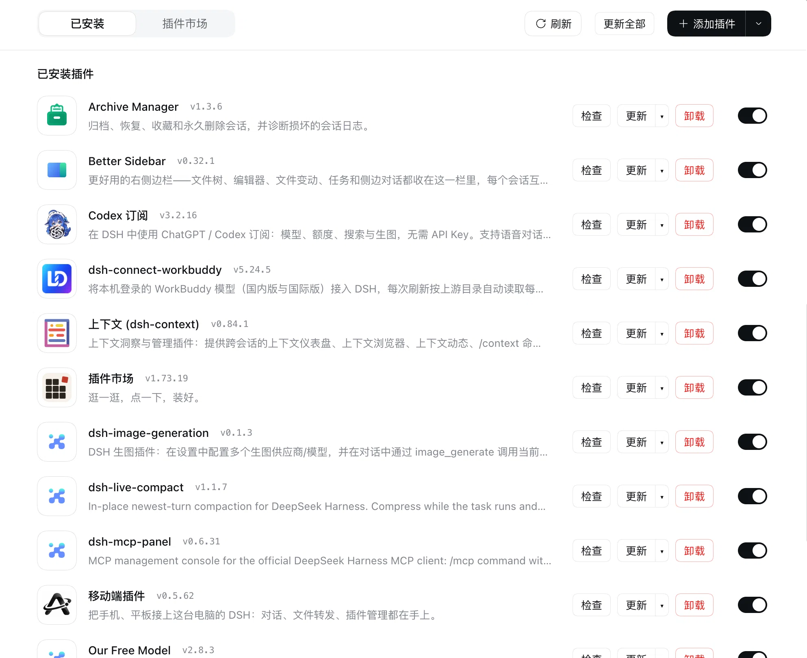
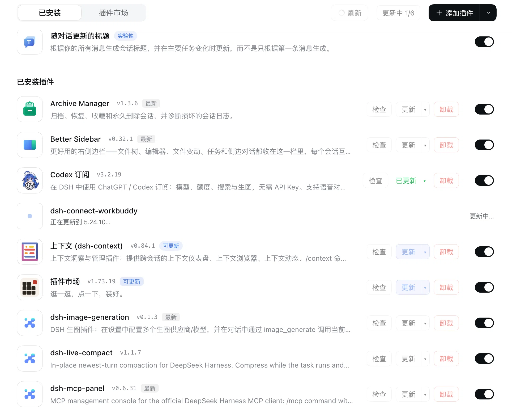

# dsh-quick-update

在 DeepSeek Harness 的「插件 → 已安装」列表里，给每个插件直接配上 **检查 / 更新 / 卸载**，不用再点进详情页；Git 安装的插件也能检查新提交。






[English summary](#english)

## 功能

- **行内按钮**（开关左侧）：`检查` `更新 ▾` `卸载`
  - `检查`：只查这一个插件（registry 或 Git 源）；
  - `更新`：有可用版本时蓝色高亮；右侧 `▾` 打开版本弹层，列出所有可安装版本（含 `latest` / `预发布` / `已弃用` / `需要更新 DSH` 标签、发布日期、安装来源），选哪个就装哪个；
  - `卸载`：红色，两次确认（第一下变"确认卸载"），调用 Host 官方卸载逻辑。
- **工具栏 `更新全部`**：逐个串行更新，显示 `更新中 n/N`，首个失败即停。**Git 安装的插件也包含在内**（从新提交重装，失败自动装回原 commit）；按钮悬停会说明其中几个是 Git 重装。
- **提交类更新的确认**：当待更新项里包含「只有新 Git 提交、没有发布新版本号」的插件时，会先弹一个确认：`全部更新` / `跳过这些插件` / `取消`。选「跳过」则只更新有正式版本的插件。
- **跟随页面刷新**：点页面自带的 `刷新` 会同时触发本插件的逐行检查，每行依次显示「检查中…」，完成后按钮变蓝；不会在进入页面时偷偷检查。
- **名字右侧状态标签**：`最新`（灰）/ `可更新`（蓝，页面没自己打标签时补位）/ `可更新但最新版不兼容当前版本 DSH`（黄，悬停给出所需依赖）。
- **页面模式下自动关闭原生更新框**：页面自己的更新确认框是带模糊遮罩的模态，插件在更新结束后（成功或失败）会主动关闭它，避免整页一直模糊。
- **合并计数**：页面自带的「N 个插件可更新」只统计能装的新版本；只要存在 Git 提交更新，本插件就把那句话替换为合并口径：`N 个插件可更新（含 M 个 Git 新提交）`（灰色 native 文案会被隐藏，悬停解释口径），`更新全部` 的数量与它一致。
- **Git 源支持**：读 `pnpm-lock.yaml` 得到已安装 commit，用 `git ls-remote` 比对远端分支；更新时先卸载再装指定 commit，失败自动装回原 commit。GitHub 等 host 走自动探测的系统代理。

- 更新期间该行会被同尺寸占位行顶住，不再"消失"。

## 安装

任选其一，装完**重启一次 DSH**（Host 半边要注册 Git 检查路由）：

```bash
# 从 GitHub 安装
dsh plugin add github:zghoto/dsh-quick-update

# 或本地目录
dsh plugin add /path/to/dsh-quick-update
```

也可以在「插件」页 → `添加插件` → `安装第三方插件` 里选目录 / 粘贴包名。

## 要求

- DeepSeek Harness 0.2.x（使用官方 `pluginManager` remote 与页面 `data-*` 钩子）
- 仅 Git 源插件需要 `git`（macOS 自带；Windows 需装 Git for Windows）
- 支持 macOS / Windows / Linux；Windows 与 macOS 的系统代理都会被自动探测

## 原理与限制

页面只提供「整页签」级扩展点（`plugins.tab`），**没有行内动作插槽**，所以这些控件是注入页面 DOM 实现的。只使用页面的稳定数据属性：

- `[data-plugin-group="bundles"] li[data-plugin-package]` — 已安装行
- `[data-plugin-toolbar]` — 工具栏

按钮状态、检查/更新/卸载都走 Host 的 `pluginManager`（`listBundles` / `listVersions` / `updateBundle` / `removeBundle`）与页面自己的动作，结果与官方页面同源。代价是：**DSH 大版本若改动这些 data 属性，控件会静默消失**（插件只记录警告，不会弄坏页面）。

## 许可

MIT © zghoto

---

<a id="english"></a>
## English

Row-level **Check / Update / Uninstall** controls for every row of the Plugins
page, including Git-installed plugins.

- `检查` checks one plugin; `更新 ▾` updates to the chosen version (all
  installable versions with tags, dates and their source); `卸载` removes the
  bundle through the Host's own removal path after a second confirmation.
- `更新全部` updates every offered plugin one after another; Git rows are
  excluded because they require a remove-and-reinstall.
- The page's own **Refresh** also drives a per-row check, so badges and buttons
  agree with the page; nothing is checked when the page merely opens.
- Status tags beside the name: `Latest`, `Update available`, and a warning tag
  when the newest version requires a newer DSH.
- Git sources are compared with `git ls-remote`; the update installs the exact
  commit and rolls back to the previous one on failure. The system proxy is
  detected on macOS and Windows.

Install with `dsh plugin add github:zghoto/dsh-quick-update`, then restart DSH
once. Requires DSH 0.2.x; `git` is only needed for Git-installed plugins.

The Plugins page has no per-row action slot, so the controls are injected into
its DOM using stable `data-*` attributes. A future DSH release that renames
them disables the controls instead of breaking the page.

MIT © zghoto
